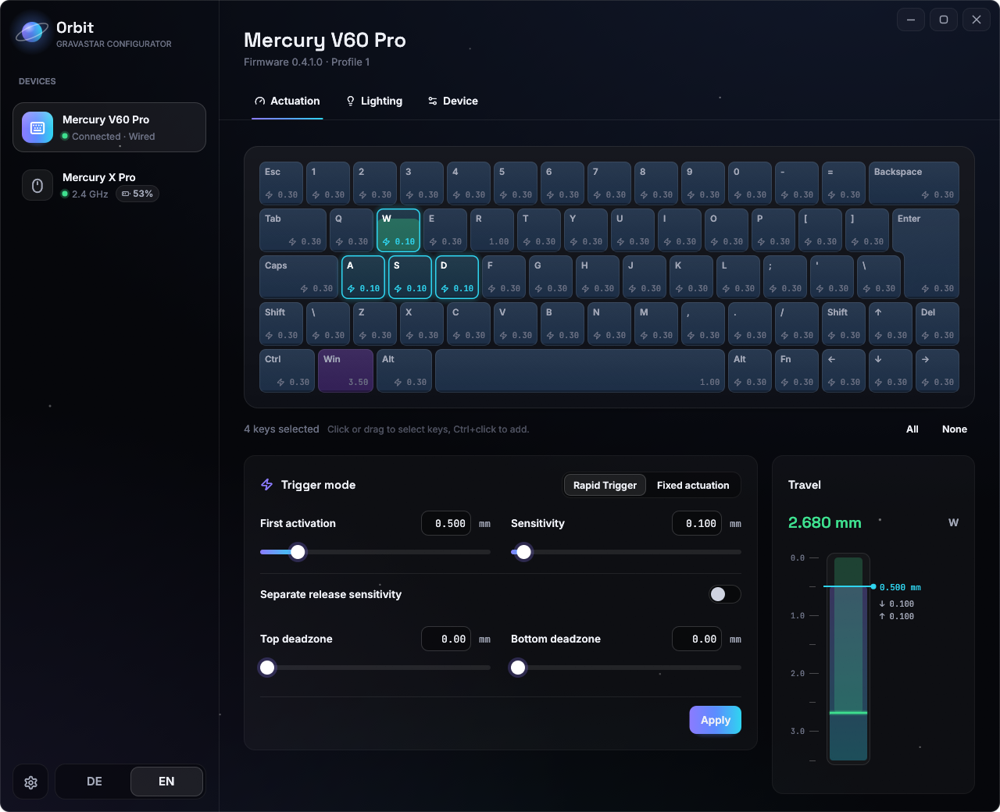
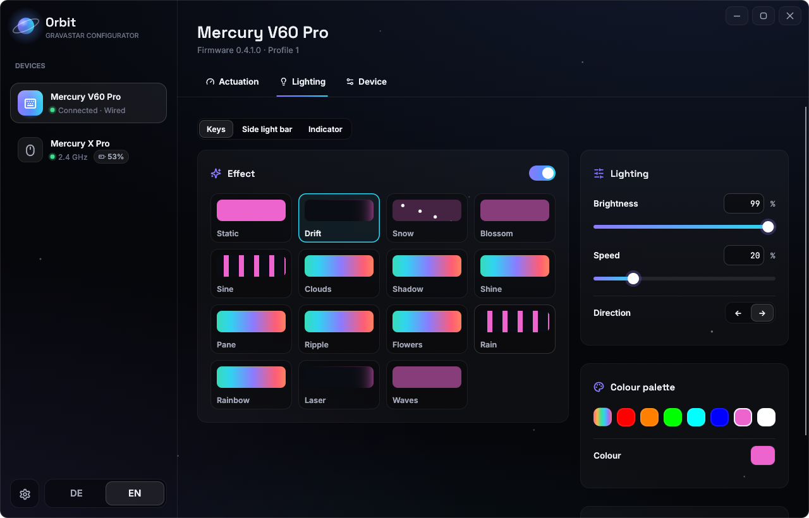
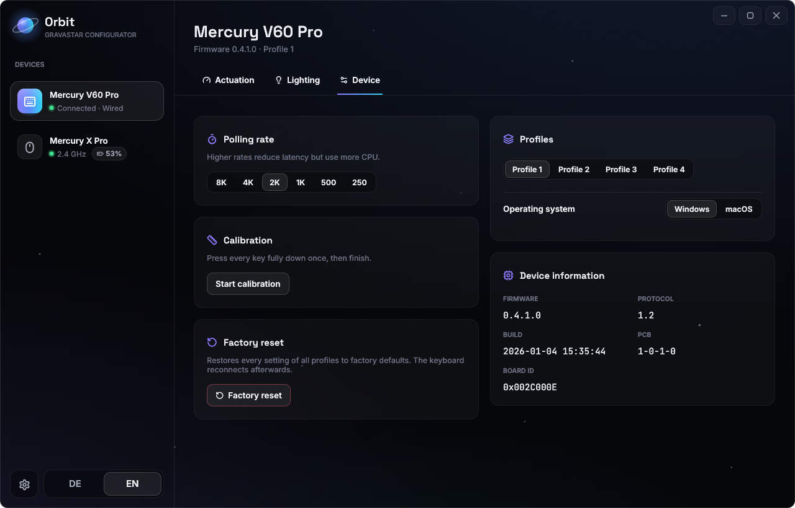
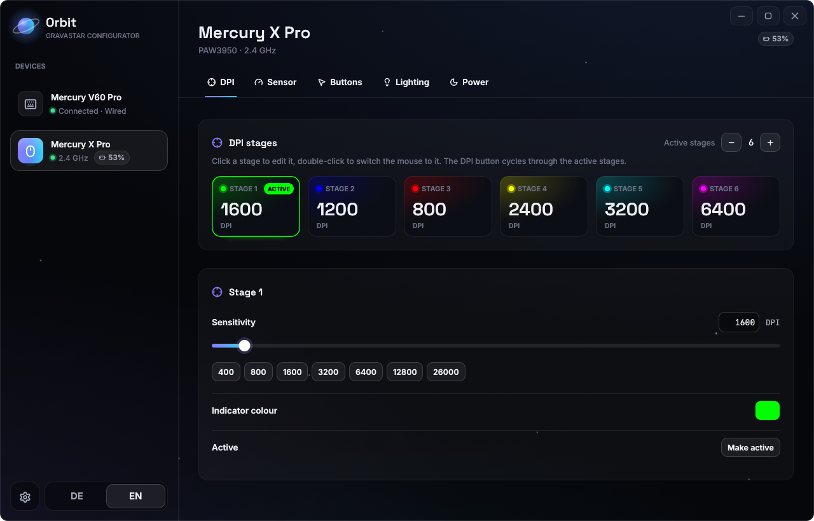
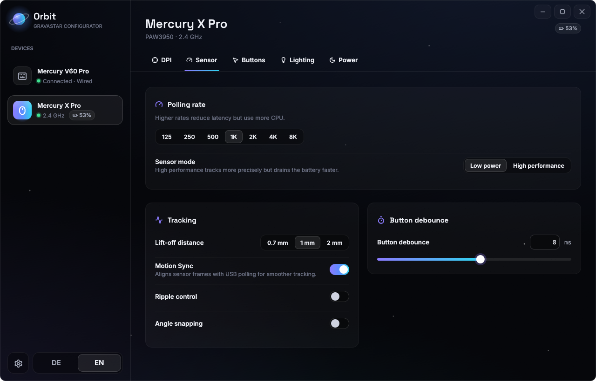
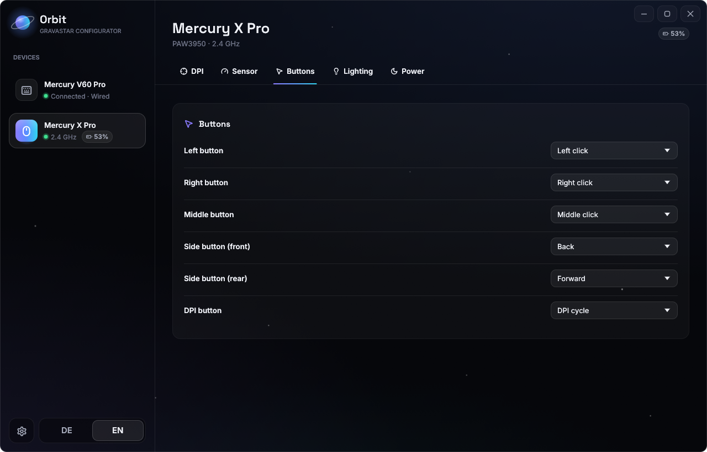
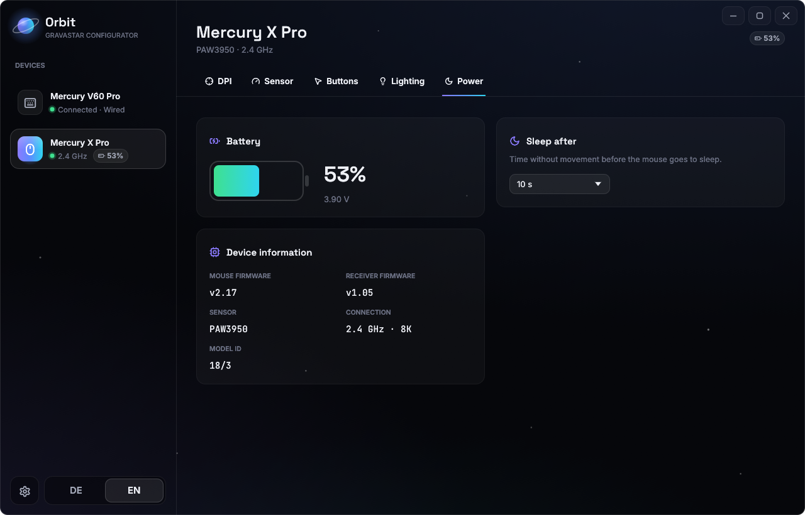
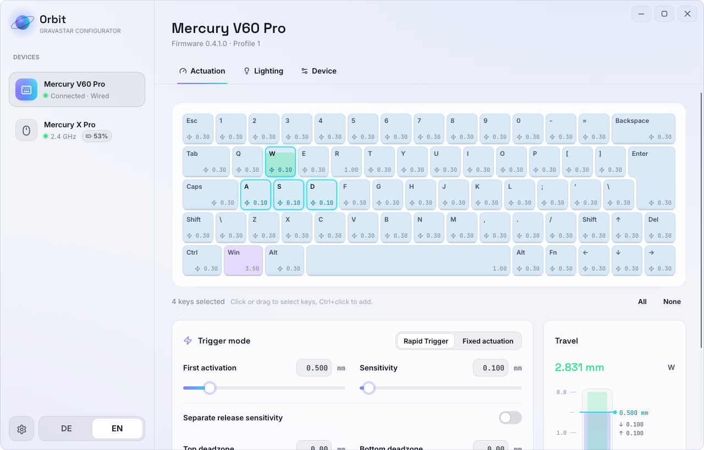
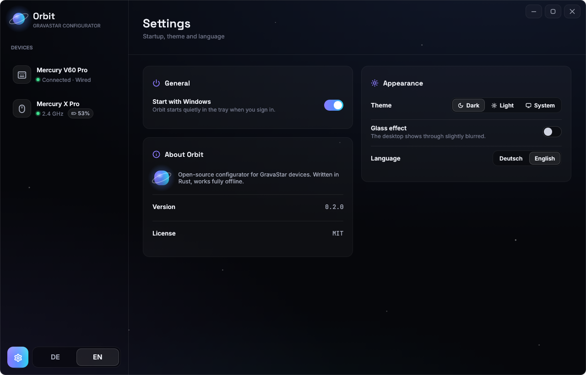
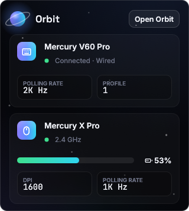

<div align="center">
  
  <h1>Orbit</h1>
  <p><strong>Open-source, fully offline configurator for GravaStar keyboards and mice.</strong></p>
  <p>100% Rust · one portable .exe · no account · no cloud · no browser engine · no network access</p>
  
</div>

---

GravaStar devices are normally configured through a web driver that only works while the vendor's
servers are online. Orbit talks to the hardware directly over USB HID, so your settings stay
adjustable no matter what happens to those servers.

Orbit is a native application written entirely in Rust. The interface is drawn with
[egui](https://github.com/emilk/egui) on the GPU — there is no WebView, no HTML and no embedded
browser. The release build is a single ~7 MB executable that only depends on DLLs that ship with
Windows, opens no network sockets and needs no installation.

> Orbit is a community project and is **not affiliated with or endorsed by GravaStar**.
> "GravaStar" and "Mercury" are trademarks of their respective owner and are used only to
> describe compatibility.

## Supported devices

| Device | Status | Features |
| --- | --- | --- |
| Mercury V60 Pro ISO (HE, `1CA6:2C0E`) | tested | per-key actuation point, Rapid Trigger, deadzones, lighting for keys / side bar / indicator, palette, polling rate up to 8 kHz, 4 profiles, OS mode, calibration, factory reset |
| Other Mercury HE keyboards (V75 Pro, V75, V75 Lite, …) | same protocol, untested | as above — the key layout is read from the keyboard itself |
| Mercury X Pro (receiver `3554:F54B`, PAW3950) | tested | battery, DPI stages with colours (up to 32 000 DPI), polling rate up to 8 kHz, LOD, Motion Sync, ripple control, angle snapping, sensor mode, debounce, button mapping, lighting, sleep timeout |

Mercury M1, M2, X and X Air use the same mouse protocol and are recognised by model id, but are untested.

Not yet supported: keymap editing, macros, advanced keys (DKS, Mod-Tap, SOCD, …) and per-key RGB.

If you own another GravaStar device, run `orbit --probe` from a terminal and open an issue with
the output — adding a model is usually a small change.

## Screenshots

<table>
  <tr>
    <td width="50%"><br /><sub><b>Keyboard lighting</b> — effects, brightness, speed and palette for keys, side bar and indicator</sub></td>
    <td width="50%"><br /><sub><b>Keyboard device</b> — polling rate, profiles, OS mode, calibration and factory reset</sub></td>
  </tr>
  <tr>
    <td><br /><sub><b>DPI stages</b> — up to eight stages with their own indicator colours</sub></td>
    <td><br /><sub><b>Sensor</b> — polling rate, sensor mode, LOD, Motion Sync, ripple control, angle snapping, debounce</sub></td>
  </tr>
  <tr>
    <td><br /><sub><b>Buttons</b> — remap every mouse button</sub></td>
    <td><br /><sub><b>Power</b> — battery level and voltage, sleep timeout, firmware versions</sub></td>
  </tr>
  <tr>
    <td><br /><sub><b>Light theme</b> — dark, light or follow Windows</sub></td>
    <td><br /><sub><b>Settings</b> — start with Windows, theme, glass effect, language</sub></td>
  </tr>
</table>

<p align="center">
  <br />
  <sub><b>Tray popup</b> — battery, DPI and polling rate at a glance</sub>
</p>

<sub>Screenshots are taken in demo mode (<code>ORBIT_DEMO=1</code>), which emulates both devices.</sub>

## Usage

Download `orbit.exe` from the [Releases](../../releases) page and start it. Settings are written to
the device immediately, exactly like the official driver does; there is no separate save button.

Orbit lives in the system tray: closing the window hides it there. Click the tray icon for a small
overview (mouse battery, DPI and polling rate; keyboard polling rate and profile), double-click it
to reopen the window, and use its context menu to quit.

The gear button in the sidebar opens the app settings: start with Windows (Orbit then starts
quietly in the tray), dark, light or system theme, a subtle glass effect and the language
(English or German).

Command-line options:

| | |
| --- | --- |
| `orbit --probe` | print what Orbit reads from every connected device (read-only) |
| `ORBIT_DEMO=1 orbit` | run with emulated devices, no hardware needed |

On Linux, grant your user access to the devices with a udev rule:

```
SUBSYSTEM=="hidraw", ATTRS{idVendor}=="1ca6", MODE="0660", TAG+="uaccess"
SUBSYSTEM=="hidraw", ATTRS{idVendor}=="3554", MODE="0660", TAG+="uaccess"
```

## Build from source

Install [Rust](https://rustup.rs). The pinned toolchain (`rust-toolchain.toml`) is fetched
automatically. On Windows you also need the MSVC build tools.

```bash
cargo run             # debug build
cargo build --release # optimized single executable in target/release/
cargo test            # protocol unit tests
```

## How it works

```
src/
├── main.rs, app.rs        window, sidebar, tabs, dialogs
├── pages/                 keyboard and mouse settings pages
├── widgets/               custom-drawn controls, keyboard view, travel gauge
├── theme.rs               colours, fonts, gradients
├── worker.rs              background thread that owns all HID handles
├── protocol/
│   ├── keyboard.rs        GravaStar HE keyboard protocol (64-byte reports)
│   ├── mouse.rs           Compx mouse protocol (flash map over report 8)
│   └── models.rs          key sizes, legends, lighting zones
├── hid.rs                 hidapi link + request/response helper
└── demo.rs                byte-level device emulation for ORBIT_DEMO
```

The UI never blocks on USB: it queues jobs to the worker thread and renders from a shared
snapshot. Device protocols are documented in [`docs/protocol-keyboard.md`](docs/protocol-keyboard.md)
and [`docs/protocol-mouse.md`](docs/protocol-mouse.md); they were derived from the vendor's public
web driver for interoperability and verified on real hardware.

## Safety

Orbit never sends firmware-update, bootloader, pairing or flash-erase commands. Mouse writes are
restricted to a fixed list of verified settings addresses. Settings are written with the same
commands the official driver uses. Still: this is unofficial software — use it at your own risk.

## License

[MIT](LICENSE). Bundled fonts: Inter, Space Grotesk and JetBrains Mono (SIL Open Font License),
Lucide icons (ISC) — see `assets/fonts/`.
